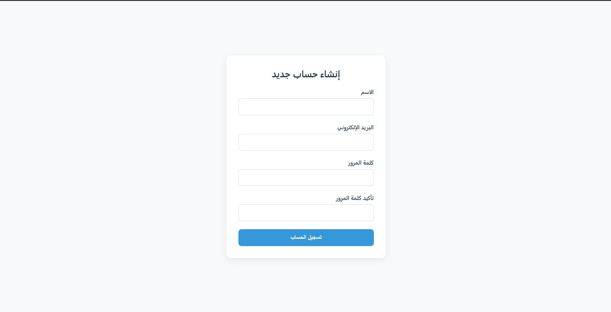
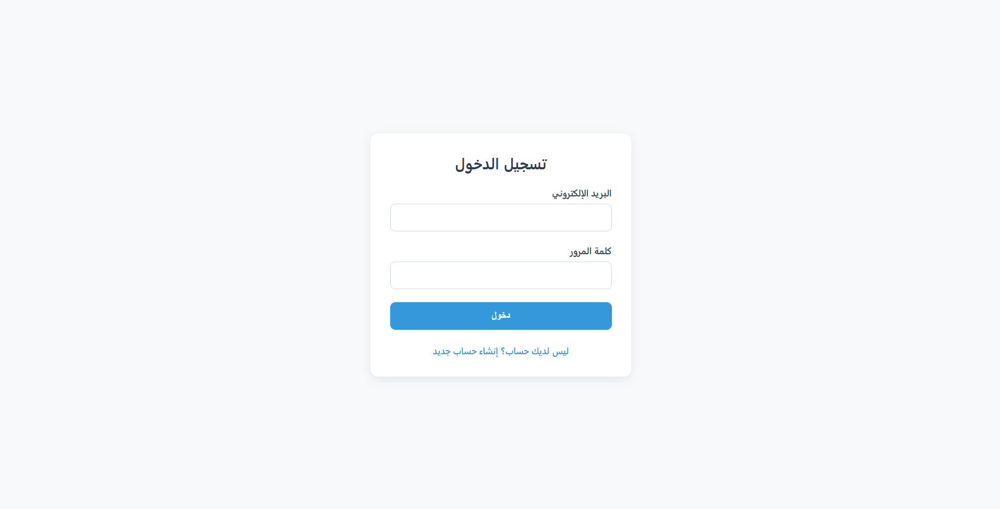
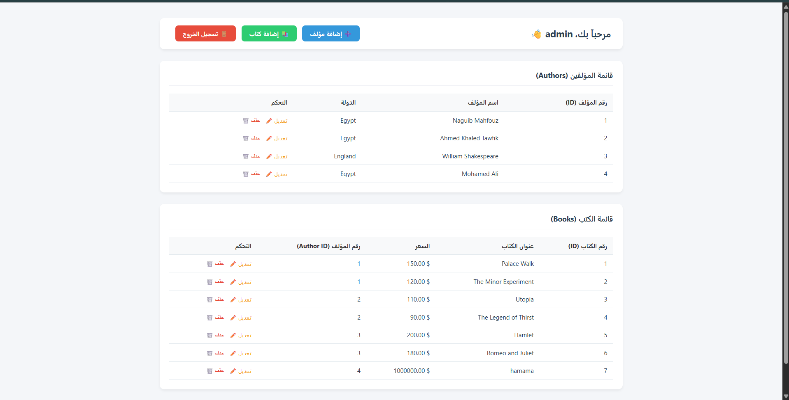
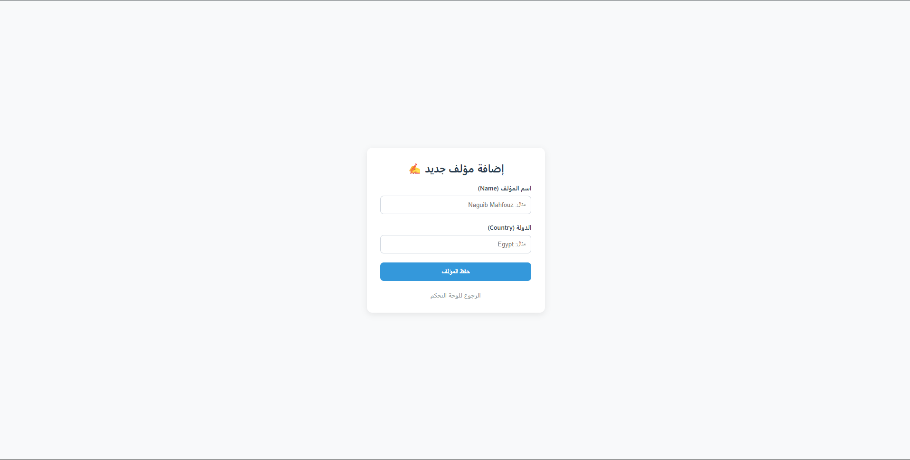
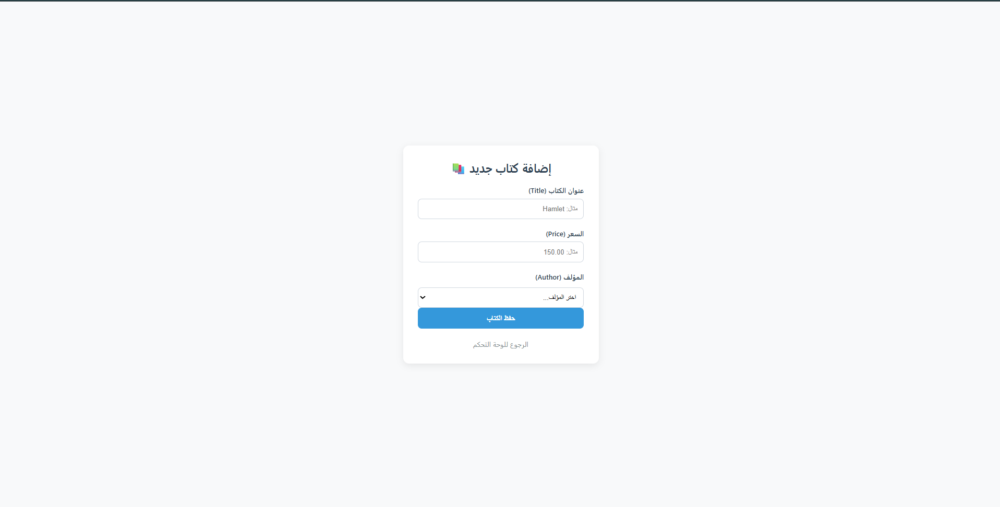
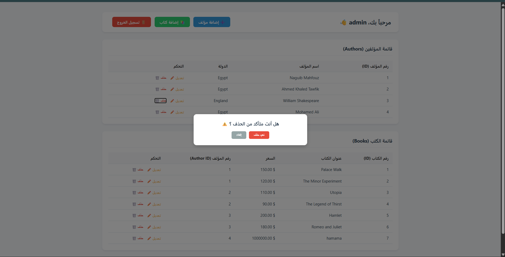

# Library Management System

A web-based library management system where users can sign up, log in, and manage authors and books. Users can add, view, edit, and delete records through a simple and responsive interface.

**Course:** Database Systems Lab  
**Faculty:** Alexandria National University


## 1. Team

| Name | ID | What this person did |
|---|---|---|
| Mohamed Ali Mohamed |2304105 | Database design, MySQL, Flask backend, authentication, and CRUD operations |
| Waleed Mohamed Ibrahim | 2304097 | [Frontend design, CSS, JavaScript, testing, or other contributions] |


## 2. Technology

- **Back end:** Python with Flask
- **Front end:** HTML5, CSS3, and JavaScript
- **Database:** MySQL (database name: `library_db`), using plain SQL without an ORM
- **Database connection:** `mysql-connector-python`
- **Authentication:** Flask sessions and Werkzeug password hashing
- **Interface:** Responsive design with Arabic (RTL) support

## 3. How to Run It

1. Install **Python** and **MySQL Server**. MySQL Workbench can be used to manage the database.
2. Download or clone this project from GitHub.
3. Open MySQL Workbench and connect to your local MySQL Server.
4. Create the database and tables using the project's SQL script, if one is included. The database name is `library_db`. If no SQL script is provided, create the tables using the schema described in the Database section.
5. Configure the database connection in the Flask application using your local MySQL username, password, host, and database name. Use environment variables if the application has been configured to support them.
6. Open a terminal in the project folder and install the required packages:

```bash
pip install Flask mysql-connector-python Werkzeug
```

7. Start the application:

```bash
python app.py
```

8. Open the local website in your browser:

```text
http://127.0.0.1:5000
```

**Note:** The application must be running in the terminal while you use the website. The exact installation commands and database configuration may differ depending on the files included in the project.

## 4. Database Design

The application uses a MySQL database named `library_db` with three main tables.

### Users

Stores registered user accounts.

| Column | Description |
|---|---|
| `id` | Primary key, auto-increment |
| `name` | User's name |
| `email` | User's email, unique |
| `password` | Hashed password |

### AUTHOR

Stores information about book authors.

| Column | Description |
|---|---|
| `author_id` | Primary key, auto-increment |
| `name` | Author's name |
| `country` | Author's country |

### BOOK

Stores information about books and their authors.

| Column | Description |
|---|---|
| `book_id` | Primary key, auto-increment |
| `title` | Book title |
| `price` | Book price |
| `author_id` | Foreign key referencing `AUTHOR(author_id)` |

**Relationship:** One author can have multiple books. Each book references an author through `author_id`.

**Referential integrity:** The foreign key uses `ON DELETE CASCADE`, so deleting an author automatically deletes the books associated with that author.

## 5. Features

- **R1 — Registration:** Users can create an account by providing their name, email, and password. Email addresses must be unique.
- **R2 — Login and Logout:** Registered users can log in and log out. Flask sessions maintain the authenticated user's state.
- **R3 — Protected Dashboard:** Only authenticated users can access the dashboard.
- **R4 — View Authors:** Display author records in a structured table.
- **R5 — Add Authors:** Insert new authors into the database.
- **R6 — Edit Authors:** Update existing author information.
- **R7 — Delete Authors:** Delete authors using POST-based forms. Associated books are deleted through the foreign key's cascade rule.
- **R8 — View Books:** Display book records and their associated information.
- **R9 — Add Books:** Insert new books and select an existing author from a dropdown list.
- **R10 — Edit Books:** Update a book's information, including its title, price, and author.
- **R11 — Delete Books:** Delete individual book records.
- **R12 — Database Integration:** Flask communicates with MySQL using `mysql-connector-python` and SQL queries without an ORM.
- **R13 — Password Security:** Passwords are hashed using Werkzeug instead of being stored as plain text.
- **R14 — User Interface:** Consistent styling, responsive layouts, Arabic right-to-left support, and JavaScript confirmation dialogs for delete actions.

## 6. Screenshots

Add screenshots of the actual application in the `screenshots/` directory.

**Registration page:**



**Login page:**



**Dashboard showing authors and books:**



**Add or edit author page:**



**Add or edit book page:**



**Delete confirmation dialog:**



## 7. Database Systems Questions and Answers

**(a) What is the purpose of a primary key in the `AUTHOR` and `BOOK` tables?**

A primary key uniquely identifies each record in a table. For example, `author_id` identifies an author, while `book_id` identifies a book. This allows records to be referenced and updated reliably.

**(b) Why does the `BOOK` table contain a foreign key referencing `AUTHOR`?**

The `author_id` foreign key establishes a relationship between books and authors. It ensures that a book references an existing author and maintains referential integrity.

**(c) What happens if we insert a book with an `author_id` that does not exist?**

MySQL rejects the insertion because it violates the foreign key constraint. This commonly produces error code `1452` for a foreign key constraint violation.

**(d) What does `ON DELETE CASCADE` do?**

When an author is deleted, MySQL automatically deletes all books referencing that author. This prevents orphaned book records, but it also means that deleting an author can permanently remove multiple books.

**(e) Why are passwords stored as hashes instead of plain text?**

Password hashing reduces the risk of exposing users' actual passwords if the database is compromised. Werkzeug provides password-hashing and password-verification functions. The application stores the hash and verifies submitted passwords during login.

**(f) Why does the application use Flask sessions?**

Sessions allow the application to maintain authentication state between requests. After a successful login, the application can identify the authenticated user and restrict access to protected routes, such as the dashboard.

**(g) Why should database queries use parameterized SQL?**

Parameterized queries separate SQL commands from user-supplied values. This helps prevent SQL injection and ensures that user input is treated as data rather than executable SQL.

**(h) Why are delete operations submitted using POST forms?**

POST forms allow the application to perform deletion through an explicit state-changing request instead of a normal navigation link. The server should also validate the request and enforce authorization before deleting records.

---

## 8. Conclusion

The Library Management System demonstrates how a relational database can be integrated with a web application using Flask and MySQL. It applies database concepts such as primary keys, foreign keys, referential integrity, CRUD operations, and cascading deletes, while providing authentication and a user-friendly interface.

The project provides practical experience in connecting a frontend to a backend and managing database records through a local web application.
